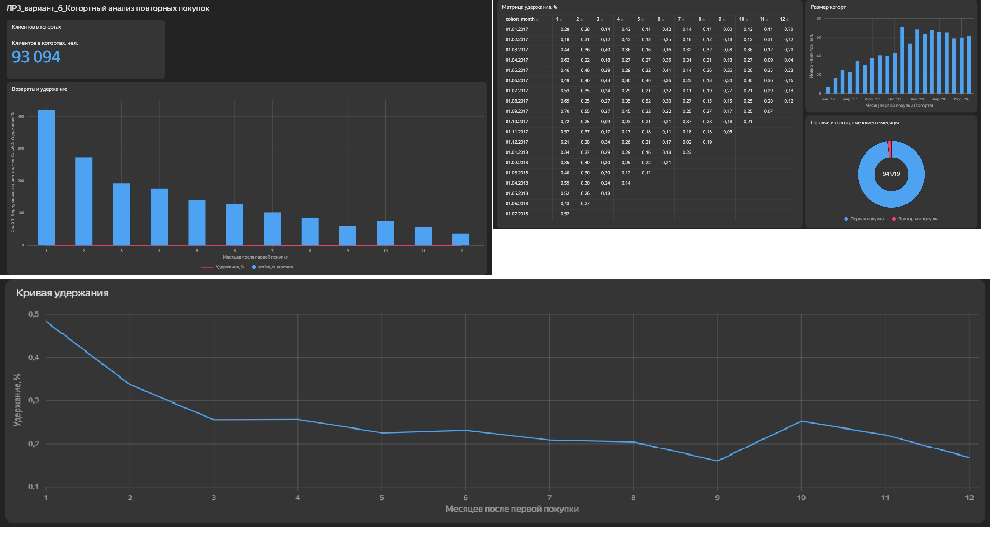

# ЛР-3. Аналитический дашборд для бизнес-кейса — вариант 6

**Студент:** Буц Игорь Денисович · **группа:** БД-251м
**Бизнес-кейс:** Когортный анализ повторных покупок

## Цель работы
Какая доля клиентов каждой когорты (месяц первой покупки) возвращается в следующие месяцы?

## Исследуемые метрики
- **Удержание, %** = `SUM([active_customers]) / SUM([cohort_size]) * 100`

## Архитектура решения
Kaggle (Olist, 9 CSV) → Python (`urllib`, `pandas`) → SQLite: RAW → STAGING → CORE → витрина `dm_v06_cohorts` → CSV → Yandex DataLens.

## Технологический стек
Python 3.13.18, pandas 2.2.3, SQLite 3.45.1, Google Colab / Jupyter, Yandex DataLens.

## Схема данных
Слои: `raw_*` (9 таблиц) → `stg_*` (типизация, очистка) → `core_order`, `core_item`, `dim_state` → `dm_v06_cohorts` (VIEW).
<!-- вставьте скриншот или ER-диаграмму: img/er.png -->

## SQL витрины
```sql
CREATE VIEW dm_v06_cohorts AS
WITH RECURSIVE
orders AS (                                   -- покупки: доставленные заказы
    SELECT customer_unique_id, purchase_month
    FROM core_order
    WHERE order_status = 'delivered'
),
first_purchase AS (                           -- когорта = месяц первой покупки
    SELECT customer_unique_id, MIN(purchase_month) AS cohort_month
    FROM orders
    GROUP BY customer_unique_id
),
cohort_size AS (                              -- размер когорты, полный период
    SELECT cohort_month, COUNT(*) AS cohort_size
    FROM first_purchase
    WHERE cohort_month BETWEEN '2017-01-01' AND '2018-08-01'
    GROUP BY cohort_month
),
activity AS (                                 -- активные клиенты когорты по смещению
    SELECT f.cohort_month,
           (CAST(strftime('%Y', o.purchase_month) AS INTEGER) * 12 + CAST(strftime('%m', o.purchase_month) AS INTEGER))
         - (CAST(strftime('%Y', f.cohort_month)   AS INTEGER) * 12 + CAST(strftime('%m', f.cohort_month)   AS INTEGER))
               AS month_offset,
           COUNT(DISTINCT o.customer_unique_id) AS active_customers
    FROM orders o
    JOIN first_purchase f USING (customer_unique_id)
    WHERE o.purchase_month <= '2018-08-01'
    GROUP BY 1, 2
),
offsets(n) AS (                               -- смещения 0 … 19 (2017-01 → 2018-08)
    SELECT 0 UNION ALL SELECT n + 1 FROM offsets WHERE n < 19
),
grid AS (                                     -- полная сетка: только наблюдаемые смещения
    SELECT c.cohort_month, o.n AS month_offset, c.cohort_size
    FROM cohort_size c
    JOIN offsets o ON date(c.cohort_month, '+' || o.n || ' months') <= '2018-08-01'
)
SELECT g.cohort_month,
       g.month_offset,
       date(g.cohort_month, '+' || g.month_offset || ' months')          AS activity_month,
       COALESCE(a.active_customers, 0)                                    AS active_customers,
       g.cohort_size,
       ROUND(100.0 * COALESCE(a.active_customers, 0) / g.cohort_size, 2) AS retention_pct,
       CASE WHEN g.month_offset = 0 THEN 'Первая покупка' ELSE 'Повторная покупка' END AS purchase_type
FROM grid g
LEFT JOIN activity a USING (cohort_month, month_offset)
ORDER BY g.cohort_month, g.month_offset
```

## Контрольные значения
| Вопрос | Ответ |
|---|---|
| Среднее удержание через 1 месяц, % | 0.48 |
| Когорта с наибольшим числом клиентов | 2017-11-01 |

## Дашборд DataLens
Ссылка: <!-- https://datalens.yandex/conyx4p1hc86v?_share_link=public -->

| № | Тип | Название |
|---|---|---|
| 1 | Индикатор | Клиентов в когортах |
| 2 | Сводная таблица | Матрица удержания |
| 3 | Линейная диаграмма | Кривая удержания |
| 4 | Столбчатая диаграмма | Размер когорт |
| 5 | Кольцевая диаграмма | Первые и повторные клиент-месяцы |



## Выводы и бизнес-рекомендации
1. <!-- вывод 1 с цифрой с дашборда -->
2. <!-- вывод 2 -->
3. <!-- рекомендация для бизнеса -->
